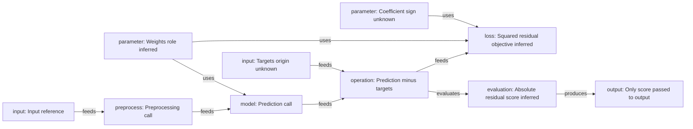

# A source-specific host GPT explanation (synthetic acceptance example)

This example was reasoned by the host GPT from the bounded observations of [train.py](../fixtures/semantic/no-manifest/train.py), then checked by the Rust inline verifier. It is not an explanation generated by the binary, a model-quality benchmark or a mathematical proof. The input directory contained only code, with no manifest; verification did not write any file into it. The candidate stayed in private scratch space; this published [copy](examples/semantic-candidate.json) contains synthetic evidence only.

## Observations

Lines 2–4 call `load_csv`, `center` and `linear`; line 5 subtracts targets from prediction. Line 6 combines a mean of multiplied residuals and a coefficient times a sum of multiplied weights. Line 7 uses `mean(abs(residual))`. Line 8 passes **only score** to `save_metrics`, with a literal output reference. No optimizer, parameter update, constraint or time evolution is observed in these eight lines. That is limited coverage, not evidence that none exists elsewhere.

## GPT interpretation (inferred)

Under ordinary arithmetic and the usual meanings of mean/sum/abs, a plausible reading is

\(r = \hat y-y\), \(L = \operatorname{mean}(r^2)+\lambda\sum w^2\), and \(score=\operatorname{mean}(|r|)\).

Here `penalty` plays the role of \(\lambda\). Its value and sign are unknown, so this is not a claim that the weights term is a positive regularizer or that the overall objective is convex. The code computes a candidate loss and a different absolute-error score; it does not show a training procedure. The input variable `targets` has no observed origin. The evidence for the expanded residual-based loss includes both lines 5 and 6.

The function called `linear` suggests a prediction step, but no implementation is observed. Likewise, `center` names a preprocessing call; actual centering is unknown. Source roles and graph relationships below are candidate interpretations with subjective confidence 0.7, not calibrated probabilities. Literal line matching succeeded and mathematical verification remains false.

## Native diagram from the verified candidate

## Counterexample and unknowns

In [train_l1.py:6](../fixtures/semantic/no-manifest/train_l1.py), the first loss term changes to `mean(abs(residual))`. The explanation must change to an absolute-error term plus the quadratic weights term, with the same arithmetic caveat. Its first loss term now matches the score expression. Reusing the squared-error explanation would be wrong. Both candidates were checked independently against their corresponding source.

The literal path `data/synthetic.csv` is only a code reference. Its actual format, schema, values, shape and split are unknown and no dataset was opened. Units, probability laws, function implementations and runtime behavior are unknown. Only score is passed to the observed output call; there is no evidence that loss is saved.

Automated tests cover observation differences, evidence freshness, bounds, origin labels and no source writes. The host GPT is responsible for this semantic reading and its caveats; tool success alone cannot certify it.
